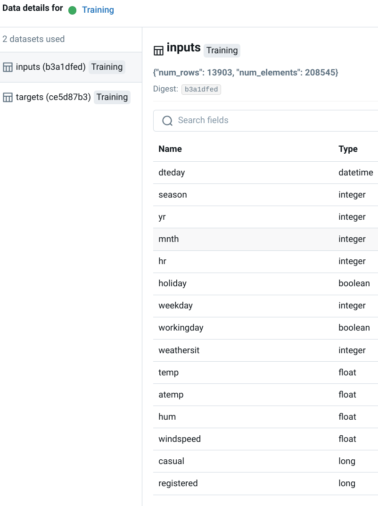

# 7.3. Lineage

<iframe class="youtube" width="560" height="315" src="https://www.youtube.com/embed/YYVeL5v-9WI?si=nlC7Dw_6C_f1AlDq" title="YouTube video player" frameborder="0" allow="accelerometer; autoplay; clipboard-write; encrypted-media; gyroscope; picture-in-picture; web-share" referrerpolicy="strict-origin-when-cross-origin" allowfullscreen></iframe>

## What is data and model lineage?

[Data and Model Lineage](https://en.wikipedia.org/wiki/Data_lineage) is the practice of tracking the complete lifecycle of data and models in a machine learning system. Think of it as a detailed audit trail that records where your data comes from, how it's transformed, how it's used to train models, and where those models are deployed.

This comprehensive record is essential for understanding, debugging, and trusting your AI/ML systems.

Key components of lineage tracking include:

- **Data Origin**: Pinpointing the source of the data, whether it's a database, API, or file system.
- **Data Transformations**: Recording every processing step, such as cleaning, feature engineering, and aggregation.
- **Model Training**: Capturing the specifics of the training process, including the exact data version, hyperparameters, and resulting model artifacts.
- **Model Deployment**: Tracking the deployment environment, version, and timeline of a model in production.

## Why is lineage a cornerstone of MLOps?

Effective data and model lineage provides several foundational benefits for mature MLOps practices:

1.  **Accelerated Debugging**: When a model underperforms or an error occurs, lineage allows you to instantly trace the problem back to its root cause, whether it's a faulty data source or a problematic transformation.
1.  **Robust Governance and Compliance**: Lineage creates a transparent, auditable record of data usage and model history, which is critical for meeting regulatory requirements like GDPR and ensuring ethical AI practices.
1.  **Support for Reproducibility**: It provides a precise blueprint of the entire model creation process, enabling you to reliably reproduce experimental results, models, and predictions.
1.  **Proactive Impact Analysis**: Before implementing changes, you can use lineage to foresee the potential impact on downstream models and applications, preventing unexpected failures.

## What are the primary use cases for data lineage?

Data lineage provides critical insights that drive key activities within an ML project.

### Data Discovery and Understanding

Lineage simplifies the process of finding and understanding relevant datasets. By tracing a model's history, you can quickly identify its source data, explore its features, and see how it connects to other assets in your ecosystem. This accelerates new projects and helps validate data quality.

### Proactive Impact Analysis

Understanding the ripple effects of a change is vital for system stability. Lineage provides a map of data dependencies, allowing you to see which models will be affected if you alter a data source or feature engineering script. This enables you to retrain or re-validate models before issues arise in production.

### Streamlined Governance and Compliance

For industries with strict regulatory standards, lineage is non-negotiable. It provides evidence for an audit trail for data provenance, demonstrating that data is sourced, handled, and used in accordance with governance policies and legal requirements like GDPR.

### Pipeline Optimization

By visualizing the entire data flow, teams can identify bottlenecks, redundant processes, and opportunities for optimization. This leads to more efficient, cost-effective, and faster ML pipelines.

## What are the key challenges in implementing lineage?

While powerful, establishing a robust lineage system comes with challenges:

- **System Integration**: MLOps pipelines often involve diverse tools (e.g., Spark, dbt, MLflow). Integrating them to create a unified lineage graph can be complex.
- **Granularity**: Deciding on the right level of detail to track is a balancing act. Too little information is not useful, while too much can be overwhelming and costly to store.
- **Manual Effort**: While many tools automate parts of lineage capture, some steps, especially complex business logic within code, may require manual annotation.
- **Scalability**: As the number of datasets and models grows, the lineage graph can become massive and complex, requiring scalable infrastructure to manage and query it effectively.

## How to implement lineage tracking with MLflow?

The [reference dataset readers](https://github.com/fmind/mlops-python-package/blob/main/src/bikes/io/datasets.py) implement `lineage()` alongside `read()`. The Parquet reader builds an MLflow dataset with an explicit local artifact source, its schema, and a digest. Jobs log that dataset as an input to the run.

```python
import mlflow
from bikes.io import datasets

reader = datasets.ParquetReader(path="data/inputs_train.parquet")
data = reader.read()
lineage = reader.lineage(name="inputs", data=data)
with mlflow.start_run():
    mlflow.log_input(dataset=lineage, context="training")
```

This example requires the bundled Parquet inputs (or regenerated inputs from `notebooks/processing.ipynb`) and a configured tracking URI. Inspect the run's dataset panel to trace its source and digest. Preserve immutable dataset bytes separately when you need to reconstruct the run: metadata and a path do not ensure those bytes remain available.



Record important transformations as parameters or tags, document feature engineering, and connect external systems with a lineage protocol when the project needs that boundary.

## Additional Resources

- **[Example from the MLOps Python Package](https://github.com/fmind/mlops-python-package/blob/main/src/bikes/io/datasets.py)**
- [MLflow Tracking Dataset](https://mlflow.org/docs/latest/tracking.html#tracking-datasets)
- [OpenLineage](https://openlineage.io/) and [Marquez](https://marquezproject.ai/)
